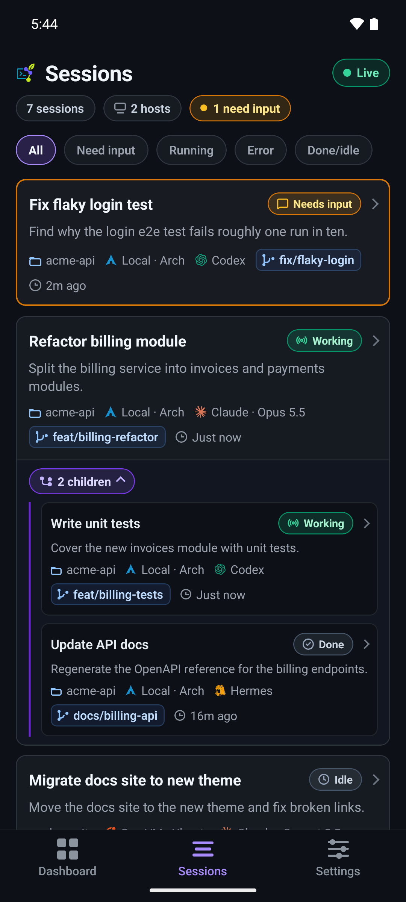

# Spawnea Mobile

Android companion app for [Spawnea](https://github.com/Growth-Push/spawnea): monitor your AI coding-agent sessions, read their output and send follow-up prompts from your phone. Built with React Native and TypeScript, with native Kotlin modules for the parts that handle credentials and network traffic.

[](https://github.com/Growth-Push/spawnea-mobile/actions/workflows/ci.yml)
[](LICENSE)


<!--
SCREENSHOTS: not captured yet. Add the images under docs/screenshots/ and
uncomment this block (see the capture list in the release report).

<p align="center">
  
  
  
  
</p>
-->

## What it is

[Spawnea](https://github.com/Growth-Push/spawnea) is a local-first desktop workspace for running and coordinating AI coding agents (Codex, Claude Code, Hermes, and others) in persistent `tmux` sessions and Git worktrees. Spawnea Mobile is its pocket view: when you are away from the desk you can check which agents are working, which need input, read what they printed, and answer them.

It is a thin client. There is no hosted backend, no account and no analytics: the app only talks to the Spawnea Desktop instance you point it at.

## How it relates to Spawnea

Spawnea Desktop exposes an optional, disabled-by-default HTTP API that is documented in [`docs/mobile-api.md`](https://github.com/Growth-Push/spawnea/blob/main/docs/mobile-api.md) and implemented in Spawnea's `apps/desktop/src/main/mobile-api-server.ts`. Spawnea Mobile is the client for that API:

| Spawnea Desktop (server) | Spawnea Mobile (this repo) |
|---|---|
| Binds to `127.0.0.1` only; you expose it to your phone yourself, for example with Tailscale Serve inside a private tailnet. | Accepts only `https://` server URLs in release builds; `http://127.0.0.1` / `localhost` is allowed in debug builds for `adb reverse` testing. |
| Authenticates with `Authorization: Bearer <key>`; stores only an Argon2id hash of the key. | Keeps the key in the Android Keystore, unlocked by strong biometrics. |
| `GET /api/v1/sessions`, `GET /api/v1/sessions/:id`, `GET .../output`, `GET .../history`, `POST .../message`. | The only endpoints the app calls ([`src/api/client.ts`](src/api/client.ts)). |

The app does not run without a reachable Spawnea Desktop instance that has the Mobile API enabled.

## Features

- **Dashboard**: session distribution by status with parent/child counts, plus honest live/stale indicators instead of showing old data as fresh.
- **Sessions**: filterable list with parent/child hierarchy and ID-based navigation, including the harness, requested model and host of each session.
- **Session / Chat**: conversation history, live terminal output with a fullscreen reader, and follow-up prompts sent with idempotent delivery so a retry never double-sends.
- **Settings**: server URL and API key management with connection test.
- Foreground polling (10 s by default); polling pauses when the app leaves the foreground.

## Build and run

### Prerequisites

- Node.js `>= 22.11.0` and npm
- JDK 17 (the version CI uses; `javac` is required by Gradle)
- Android SDK: compileSdk `37`, targetSdk `36`, minSdk `24` (Android 7.0), build-tools `37.0.0`, NDK `27.1.12297006`
- `JAVA_HOME`, `ANDROID_HOME` and `ANDROID_SDK_ROOT` set in your shell
- A device or emulator with a **strong biometric enrolled** (for example a fingerprint): the app has no PIN fallback

### Install and verify

```bash
npm ci --ignore-scripts
npm run typecheck
npm run lint
npm test -- --watchAll=false
cd android && ./gradlew :app:testDebugUnitTest
```

### Run a debug build

With a device or emulator connected:

```bash
npm start            # Metro bundler, in one terminal
npm run android      # install and launch, in another
```

Or build a standalone debug APK (JavaScript bundled in) and install it:

```bash
cd android && ./gradlew assembleDebug
adb install app/build/outputs/apk/debug/app-debug.apk
```

### Connect it to Spawnea Desktop

1. Enable the Mobile API in Spawnea Desktop and generate a key hash, as described in the [Spawnea mobile API guide](https://github.com/Growth-Push/spawnea/blob/main/docs/mobile-api.md).
2. Open **Settings** in the app, enter the server URL and the plaintext key, and run **Test connection**.
   - Same machine as an emulator, debug build only: `adb reverse tcp:5757 tcp:5757`, then use `http://127.0.0.1:5757`.
   - Real phone: expose the desktop port inside your private tailnet with `tailscale serve --bg --https=5757 http://127.0.0.1:5757` and use `https://<machine>.<tailnet>.ts.net:5757`. Never use Tailscale Funnel.

### Release APK

```bash
cd android && ./gradlew assembleRelease
```

Without signing settings this produces an **unsigned** APK (`android/app/build/outputs/apk/release/app-release-unsigned.apk`) for verification or external signing. To sign it, provide all four of these as environment variables or Gradle properties, and keep the keystore and passwords outside version control:

- `SPAWNEA_RELEASE_STORE_FILE` (absolute path, or relative to `android/`)
- `SPAWNEA_RELEASE_STORE_PASSWORD`
- `SPAWNEA_RELEASE_KEY_ALIAS`
- `SPAWNEA_RELEASE_KEY_PASSWORD`

A partial set fails the build instead of silently falling back to the debug keystore. The `android/app/debug.keystore` in this repository is the standard public Android debug key, used only for debug builds.

## Security model

- HTTPS-only in release builds; cleartext is limited to `127.0.0.1` / `localhost` in debug builds. No Android backups.
- The API key is stored only by a native Keystore module (AES-256-GCM, key in `AndroidKeyStore`) and every unlock requires a strong biometric. Enrolling a new fingerprint invalidates the key and the app asks you to link it again.
- Network calls go through a native OkHttp module instead of React Native's networking, so the `Authorization` header is never visible to the debug inspector.
- Server URL and key are replaced atomically, with rollback if the commit fails.
- The decrypted key lives only in memory for the foreground session and is cleared when the app is backgrounded, locked out or reconfigured.

Details: [`docs/security-design.md`](docs/security-design.md). To report a vulnerability, see [`SECURITY.md`](SECURITY.md).

## Project status and limits

This is an early release (`0.0.1`) of a companion app, published as-is.

- **Android only.** There is no iOS project.
- **Needs Spawnea Desktop.** There is no demo mode or mock server, so without a running Spawnea instance with the Mobile API enabled the app has nothing to show.
- **Polling, not push.** Updates arrive every ~10 s while the app is in the foreground; there are no push notifications, WebSockets or background sync.
- **Read and reply only.** You can read sessions and send follow-up messages; you cannot create, stop or reconfigure sessions from the phone.
- **One server at a time**, one saved URL and key.
- **Strong biometrics required**; devices without an enrolled strong biometric cannot save or use a key.
- **English UI only.** Not published on Google Play; no signed release is distributed from this repository.
- **Tested with:** Jest unit and component tests, Kotlin unit tests for the native modules, and CI that builds the debug and release APKs. There are no instrumented or end-to-end UI tests, and the app has not been validated across a broad range of devices.

## Repository layout

| Path | Contents |
|---|---|
| `src/api` | Typed API client and response sanitization |
| `src/dashboard`, `src/sessions`, `src/chat` | View models, status/harness/host icons |
| `src/hooks` | Polling and sync hooks (Sessions, Chat) |
| `src/screens`, `src/navigation` | Dashboard, Sessions, Session/Chat and Settings screens |
| `src/storage` | Credential and URL storage over the native Keystore module |
| `android/app/src/main/java/.../network`, `.../security` | Native OkHttp transport and Keystore/biometric modules (Kotlin) |
| `__tests__`, `android/app/src/test` | Jest and Kotlin unit tests |

## License

Apache License 2.0, see [LICENSE](LICENSE). Third-party assets and their licenses are listed in [THIRD_PARTY_NOTICES.md](THIRD_PARTY_NOTICES.md).
