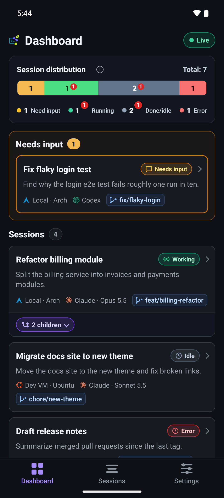
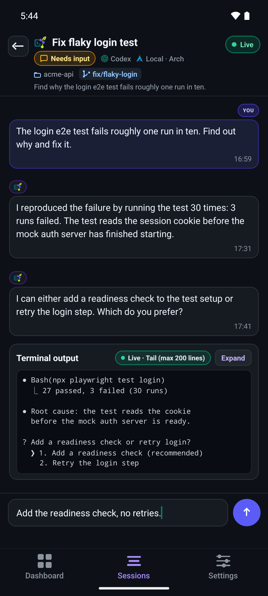
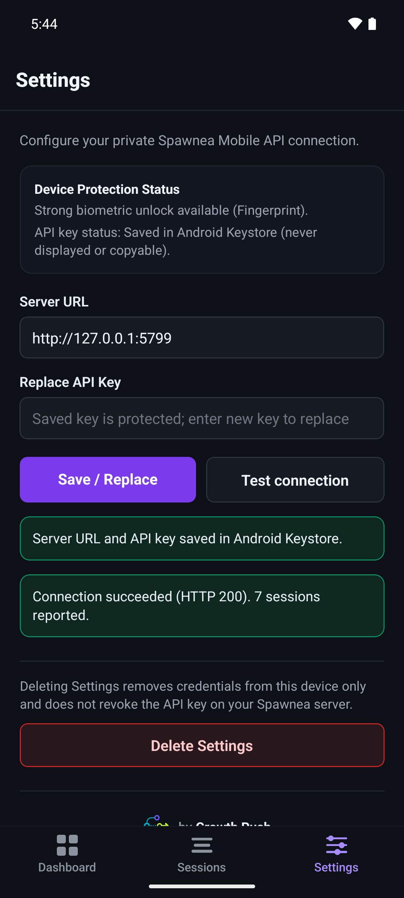

# Spawnea Mobile

Android companion app for [Spawnea](https://github.com/Growth-Push/spawnea): monitor your AI coding-agent sessions, read their output and send follow-up prompts from your phone. Built with React Native and TypeScript, with native Kotlin modules for the parts that handle credentials and network traffic.

[](https://github.com/Growth-Push/spawnea-mobile/actions/workflows/ci.yml)
[](LICENSE)


<p align="center">
  
  
  
  
</p>

<p align="center"><sub>Dashboard, Sessions, Session/Chat and Settings. Screenshots come from an Android emulator talking to a mock API with fictional sessions, not real data.</sub></p>

## What it is

[Spawnea](https://github.com/Growth-Push/spawnea) is a local-first desktop workspace for running and coordinating AI coding agents (Codex, Claude Code, Hermes, and others) in persistent `tmux` sessions and Git worktrees. Spawnea Mobile is its pocket view: when you are away from the desk you can check which agents are working, which need input, read what they printed, and answer them.

It is a thin client. There is no hosted backend, no account and no analytics: the app only talks to the Spawnea Desktop instance you point it at.

## Quick start

1. **Run Spawnea Desktop with its Mobile API enabled**: [Set up Spawnea Desktop](#1-set-up-spawnea-desktop-server-side).
2. **Install the app on your Android device.** It is not on Google Play, so you build the APK and sideload it: [Install on a device](#2-install-the-app-on-a-device-no-app-store).
3. **Enter the server URL and key in the app's Settings**: [Configure the app](#3-configure-the-app).

## How it relates to Spawnea

Spawnea Desktop exposes an optional, disabled-by-default HTTP API that is documented in [`docs/mobile-api.md`](https://github.com/Growth-Push/spawnea/blob/main/docs/mobile-api.md) and implemented in Spawnea's `apps/desktop/src/main/mobile-api-server.ts`. Spawnea Mobile is the client for that API:

| Spawnea Desktop (server) | Spawnea Mobile (this repo) |
|---|---|
| Binds to `127.0.0.1` only; you expose it to your phone yourself, for example with Tailscale Serve inside a private tailnet. | Accepts only `https://` server URLs in release builds; `http://127.0.0.1` / `localhost` is allowed in debug builds for `adb reverse` testing. |
| Authenticates with `Authorization: Bearer <key>`; stores only an Argon2id hash of the key. | Keeps the key in the Android Keystore, unlocked by strong biometrics. |
| `GET /api/v1/sessions`, `GET /api/v1/sessions/:id`, `GET .../output`, `GET .../history`, `POST .../message`. | The only endpoints the app calls ([`src/api/client.ts`](src/api/client.ts)). |

The app does not run without a reachable Spawnea Desktop instance that has the Mobile API enabled.

## Features

- **Dashboard**: session distribution by status with parent/child counts, plus honest live/stale indicators instead of showing old data as fresh.
- **Sessions**: filterable list with parent/child hierarchy and ID-based navigation, including the harness, requested model and host of each session.
- **Session / Chat**: conversation history, live terminal output with a fullscreen reader, and follow-up prompts sent with idempotent delivery so a retry never double-sends.
- **Settings**: server URL and API key management with connection test.
- Foreground polling (10 s by default); polling pauses when the app leaves the foreground.

## 1. Set up Spawnea Desktop (server side)

You need [Spawnea](https://github.com/Growth-Push/spawnea) installed and working on your computer first; follow its [getting started guide](https://github.com/Growth-Push/spawnea/blob/main/docs/getting-started.md). Then enable its Mobile API. The authoritative reference is the [Spawnea mobile API guide](https://github.com/Growth-Push/spawnea/blob/main/docs/mobile-api.md); in short:

1. **Choose a secret key** of at least 32 characters and keep it in a password manager. Hash it (the desktop stores only the hash):

   ```bash
   printf '%s' "$MOBILE_SECRET_KEY" | spawnea hash-key
   ```

2. **Enable the API** in Spawnea's `config.yaml` (by default `~/.config/spawnea/config.yaml`, or `$SPAWNEA_USER_DATA_DIR/config.yaml`), pasting the hash you just generated:

   ```yaml
   api:
     enabled: true
     port: 5757            # optional; 5757 is the default
     key_hash: "$argon2id$v=19$..."
   ```

3. **Restart Spawnea Desktop.** If `key_hash` is missing or invalid, Spawnea leaves the port closed.
4. **Make the desktop reachable from your phone.** Spawnea listens on `127.0.0.1` only, so you expose it yourself. The recommended way is [Tailscale Serve](https://tailscale.com/kb/1242/tailscale-serve) inside your private tailnet, with the Tailscale app signed in on the phone:

   ```bash
   tailscale serve --bg --https=5757 http://127.0.0.1:5757
   tailscale serve status
   ```

   Your server URL is then `https://<machine>.<tailnet>.ts.net:5757`. **Never use Tailscale Funnel**: it would expose the API to the public internet.

## 2. Install the app on a device (no app store)

Spawnea Mobile is not on Google Play and this repository does not publish ready-made APKs, so you build the APK yourself and install it directly ("sideload"). Both options below need the build prerequisites.

### Build prerequisites

- Node.js `>= 22.11.0` and npm
- JDK 17 (the version CI uses; `javac` is required by Gradle)
- Android SDK: compileSdk `37`, targetSdk `36`, minSdk `24` (Android 7.0), build-tools `37.0.0`, NDK `27.1.12297006`
- `JAVA_HOME`, `ANDROID_HOME` and `ANDROID_SDK_ROOT` set in your shell
- A phone or emulator with a **strong biometric enrolled** (for example a fingerprint): the app has no PIN fallback

```bash
git clone https://github.com/Growth-Push/spawnea-mobile.git
cd spawnea-mobile
npm ci --ignore-scripts
```

`-PreactNativeArchitectures=arm64-v8a` in the commands below builds only for 64-bit ARM, which covers most modern phones and keeps the APK small. Omit it to build all four ABIs (needed for x86 emulators).

### Option A: debug build over USB (quickest)

1. On the phone, enable Developer options and **USB debugging**, connect it with a cable and confirm `adb devices` lists it.
2. Build and install:

   ```bash
   cd android
   ./gradlew assembleDebug -PreactNativeArchitectures=arm64-v8a
   adb install -r app/build/outputs/apk/debug/app-debug.apk
   ```

The debug APK is signed with the public Android debug key and bundles its JavaScript, so it runs standalone. It is fine for trying the app; for daily use prefer Option B.

### Option B: signed release APK (recommended for daily use)

An unsigned release APK cannot be installed on a device, so create your own signing key once. Keep it **outside this repository** and back it up: updates must be signed with the same key.

```bash
keytool -genkeypair -v -keystore "$HOME/spawnea-release.keystore" \
  -alias spawnea -keyalg RSA -keysize 4096 -validity 10000
```

Build with all four signing settings (environment variables, or Gradle properties in a private `~/.gradle/gradle.properties`):

```bash
cd android
SPAWNEA_RELEASE_STORE_FILE="$HOME/spawnea-release.keystore" \
SPAWNEA_RELEASE_STORE_PASSWORD='...' \
SPAWNEA_RELEASE_KEY_ALIAS=spawnea \
SPAWNEA_RELEASE_KEY_PASSWORD='...' \
./gradlew assembleRelease -PreactNativeArchitectures=arm64-v8a
```

The signed APK is `android/app/build/outputs/apk/release/app-release.apk`. Install it with `adb install -r`, or copy it to the phone and open it from a file manager (Android will ask you to allow "Install unknown apps" for that app, and Play Protect may warn that the app is unrecognized).

A partial set of signing settings fails the build instead of silently falling back to the debug keystore. Without any of them, `assembleRelease` produces `app-release-unsigned.apk`, which is only useful for verification or external signing. The `android/app/debug.keystore` in this repository is the standard public Android debug key, used only for debug builds.

## 3. Configure the app

1. Open the **Settings** tab.
2. **Server URL**: enter your server's base URL, for example `https://<machine>.<tailnet>.ts.net:5757`. It must be `https://`, without a path, credentials or query string. (Debug builds on an emulator may use `http://127.0.0.1:5757` after `adb reverse tcp:5757 tcp:5757`.)
3. **API Key**: enter the plaintext key whose hash you put in Spawnea's `config.yaml`.
4. Tap **Save** and authenticate with your strong biometric (for example a fingerprint) when asked. The key is stored in the Android Keystore and is never shown again.
5. Tap **Test connection**. Success reads `Connection succeeded (HTTP 200). N sessions reported.`
6. Open **Dashboard** or **Sessions**.

Good to know:

- **Rotating the key:** generate a new hash, update `key_hash`, restart Spawnea Desktop, then enter the new key under **Replace API Key** in Settings.
- **Delete Settings** removes the URL and key from the phone only; it does not revoke the key on your Spawnea server.
- **If Test connection fails:** check that Spawnea Desktop is running with the API enabled, `tailscale serve status` shows the port, the phone is signed in to the same tailnet, the URL is `https://` with the right port, and the key matches the saved hash.

## Development

```bash
npm run typecheck
npm run lint
npm test -- --watchAll=false
cd android && ./gradlew :app:testDebugUnitTest
```

To run against Metro with a connected device or emulator:

```bash
npm start            # Metro bundler, in one terminal
npm run android      # install and launch, in another
```

### How changes are reviewed

Every change goes through a pull request. CI runs ESLint, the TypeScript check, Jest, the Android unit tests with debug and release APK builds, a `gitleaks` secret scan over the full history, and `npm audit`. Pull requests also receive automated AI code review from OpenAI Codex (see the merged pull requests for examples).

<!-- Uncomment once CodeRabbit is installed on this repository:
CodeRabbit also reviews pull requests on this repository. -->

## Security model

- HTTPS-only in release builds; cleartext is limited to `127.0.0.1` / `localhost` in debug builds. No Android backups.
- The API key is stored only by a native Keystore module (AES-256-GCM, key in `AndroidKeyStore`) and every unlock requires a strong biometric. Enrolling a new fingerprint invalidates the key and the app asks you to link it again.
- Network calls go through a native OkHttp module instead of React Native's networking, so the `Authorization` header is never visible to the debug inspector.
- Server URL and key are replaced atomically, with rollback if the commit fails.
- The decrypted key lives only in memory for the foreground session and is cleared when the app is backgrounded, locked out or reconfigured.

Details: [`docs/security-design.md`](docs/security-design.md). To report a vulnerability, see [`SECURITY.md`](SECURITY.md).

## Project status and limits

This is an early release (`0.0.1`) of a companion app, published as-is.

- **Android only.** There is no iOS project.
- **Needs Spawnea Desktop.** There is no demo mode or mock server, so without a running Spawnea instance with the Mobile API enabled the app has nothing to show.
- **Polling, not push.** Updates arrive every ~10 s while the app is in the foreground; there are no push notifications, WebSockets or background sync.
- **Read and reply only.** You can read sessions and send follow-up messages; you cannot create, stop or reconfigure sessions from the phone.
- **One server at a time**, one saved URL and key.
- **Strong biometrics required**; devices without an enrolled strong biometric cannot save or use a key.
- **English UI only.** Not published on Google Play; no signed release is distributed from this repository.
- **Tested with:** Jest unit and component tests, Kotlin unit tests for the native modules, and CI that builds the debug and release APKs. There are no instrumented or end-to-end UI tests, and the app has not been validated across a broad range of devices.

## Repository layout

| Path | Contents |
|---|---|
| `src/api` | Typed API client and response sanitization |
| `src/dashboard`, `src/sessions`, `src/chat` | View models, status/harness/host icons |
| `src/hooks` | Polling and sync hooks (Sessions, Chat) |
| `src/screens`, `src/navigation` | Dashboard, Sessions, Session/Chat and Settings screens |
| `src/storage` | Credential and URL storage over the native Keystore module |
| `android/app/src/main/java/.../network`, `.../security` | Native OkHttp transport and Keystore/biometric modules (Kotlin) |
| `__tests__`, `android/app/src/test` | Jest and Kotlin unit tests |

## License

Apache License 2.0, see [LICENSE](LICENSE). Third-party assets and their licenses are listed in [THIRD_PARTY_NOTICES.md](THIRD_PARTY_NOTICES.md).
